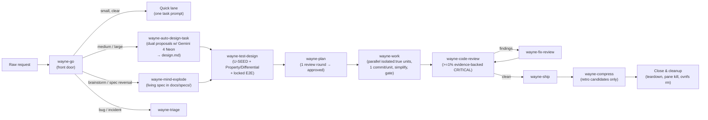

# Wayne Skills

Wayne's control-plane skill library, global invariants, and agent harness config (`omp`, `pi`, Claude Code, Codex). This repository is the single source of truth (`WAYNE_SKILLS_DIR` in `~/.wayne/config.env`); consumers symlink directly here via `bash sync.sh` (see [SYNC.md](SYNC.md)).

## Recommended workflow (2026-11)

The core operating model is **one coordinator + isolated autonomous sessions**, with every stage backed by executable proof instead of prose claims.

### 1. Coordinator & delegation (`wayne-inbox`)
- **Coordinator stays thin**: reads the ledger/RESULTs, routes work, answers questions from evidence, escalates only real decisions to Wayne (plain Chinese, 2–3 options with recommendation), and verifies claimed outcomes at source (`gh pr view`, live runtime checks). Never edits product code inline.
- **One isolated checkout per task**: every new task runs in its own `ovnfs` checkout (`ovnfs new --name <topic> --rev origin/main` from the source repo root) inside a `tern` session, registered via `inbox agent add` with a completion `then` trigger — push, never poll.
- **Check direct user replies**: before re-asking Wayne about a watched session's open question, check all `role: "user"` messages in that session's `.jsonl` since the last check.
- **Model routing**: execution subagents use the default/`task` model (never Opus unless Wayne authorizes it); UI/design Gemini steps use exact `gemini-4-neon` selector; review voices keep their own configured model.

### 2. Design & test bar (`wayne-auto-design-task`, `wayne-test-design`, `wayne-plan`)
- **Medium/large tasks default to `wayne-auto-design-task`**: main model + Gemini 4 Neon draft independent proposals → fused `design.md` (with `## Invariants`) → Gemini interaction/copy review for UI → `wayne-test-design` → `wayne-plan` (single review round) → `wayne-work`. Use `wayne-mind-explode` only when Wayne wants an interview loop or the change reverses a living spec in `docs/specs/`.
- **Proportional test bar**:
  - **Unit + changed-branch coverage** (`diff-cover`) + **Bug-fix red→green** (seeded fakes must cite the production line that writes that state, else drive the real write path).
  - **Property & Differential tests** (`Hypothesis` / `fast-check`): required (or explicit `none — <reason>`) whenever touching state machines, parsers, migration/rollback round-trips, concurrency monotonicity, or rewrites with an existing oracle; `wayne-plan` never silently downgrades a `property` seed to a single example unit test.
  - **UI changes**: real browser verification + before/after screenshots shown to Wayne.
  - **Hot deploy by default**: every design states how in-flight state survives a mid-operation deploy with old and new builds running together.

### 3. Execution, review & verification (`wayne-work`, `wayne-code-review`, `wayne-fix-review`)
- **`wayne-work`**: dispatches ready DAG units in parallel (`isolated: true`), one signed commit per unit (`git commit -s`), runs `wayne-simplify` once on the full diff, then runs an independent whole-diff spec-compliance gate.
- **`wayne-code-review`**: multi-source (structured + Voice 1 + Voice 2 + design-conformance) against the frozen base/head range and repo rule ledger.
  - **CRITICAL gate**: requires **≥ 1% estimated per-run probability** (with stated evidence — logs, run counts, load — and only multiplying independent factors) **AND** a serious impact (crash, data loss/corruption, wrong user-visible result, stuck resource). Below 1% is `INFORMATIONAL` with no fix/test requested (security/authz holes excepted).
  - **Eval loop**: weekly scorecard + curated false-positive/miss cases frozen into `eval/wayne-code-review/cases/`.
- **`wayne-fix-review`**: treats comments as hypotheses; verifies at source first, plans fixes in the main model before dispatching workers, never passes raw review comments to subagents.

### 4. Wrap-up: retro & mandatory cleanup (`wayne-compress`, `wayne-inbox/references/delegate.md`)
- After a watched session finishes (`status: done`), run one unattended `wayne-compress` retro round (candidates only, apply nothing) and present a short curated table to Wayne.
- **Mandatory 4-step `Close`** once all owned PRs merge (or a no-PR run completes retro):
  1. Confirm zero open PRs remain in `rules.yaml`.
  2. **Teardown before killing the pane**: stop/remove session-owned Docker stacks/containers/dev servers, remove `/tmp/<prefix>-*` and secret env files, prune task `context.md` (keep `RESULT*.md`).
  3. `inbox agent close <name> --ack <version> --note "<verified & cleaned>"`, then kill the pane.
  4. Remove the checkout (`ovnfs rm <name>` / `git worktree remove`).

## Skill index

| Category | Skills |
| --- | --- |
| Entry & routing | `wayne-go`, `wayne-goal-prompt`, `wayne-inbox`, `wayne-checkpoint` |
| Design & planning | `wayne-auto-design-task`, `wayne-mind-explode`, `wayne-frontend-design`, `wayne-test-design`, `wayne-plan` |
| Build & fix | `wayne-work`, `wayne-triage`, `wayne-fix-review`, `wayne-simplify`, `wayne-verify`, `wayne-ship` |
| Review & quality | `wayne-code-review`, `wayne-compress`, `wayne-distill`, `wayne-context-audit` |
| Context & knowledge | `wayne-context-init`, `wayne-codebase-report`, `wayne-manner`, `wayne-neat`, `wayne-explain`, `waynejing` |
| Authoring & ops | `wayne-skill-forge`, `wayne-skill-optimize`, `wayne-cybernetics`, `wayne-visual-synthesis`, `wayne-rescue-boot` |

## Setup on a new machine

1. Create `~/.wayne/config.env` pointing `WAYNE_SKILLS_DIR` to your clone of this repo (and `WAYNE_KB_DIR` if mounted).
2. Run `bash "${WAYNE_SKILLS_DIR}/sync.sh"` — links `CLAUDE.md`/`AGENTS.md`, skills, `pi-config/` extensions, and `omp-config/` agents/extensions/plugins.
3. Keep personal dev-env/host specifics in `~/.wayne/CONTEXT.md`; keep product terminology inside each repo (e.g. `docs/current_status/glossary.md`). See [SYNC.md](SYNC.md) for the exact symlink topology.
