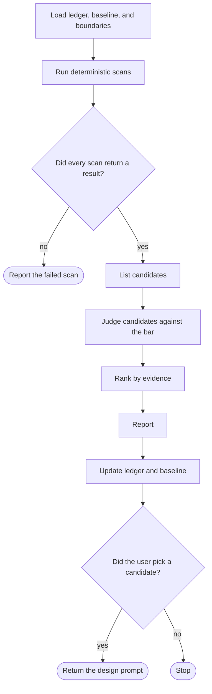

# Wayne Arch Sweep

Find the structural drift that many small changes produced, and return a short list of candidates that evidence supports.

## Boundary

| Skill | Owns |
| --- | --- |
| `wayne-neat` | Docs, memory, and comments against the code. This skill does not edit them. |
| `wayne-code-review` | One diff. This skill reads the whole repository across many changes. |
| `wayne-simplify` | The diff that was just written. |
| `wayne-auto-design-task`, `wayne-mind-explode` | The design of a picked candidate. This skill never designs the fix. |

The checks live in [the architecture bar](../wayne-mind-explode/references/architecture-bar.md). Read the bar in D. Do not restate its checks in the report.

## Flow



## Process

### A. Load ledger, baseline, and boundaries

Resolve `<state>` with `../_shared/scripts/wayne-state-dir.sh`. The sweep keeps its state in `<state>/arch-sweep/`:

- `ledger.md`: one row for each candidate that a sweep raised, with the date, the verdict (`picked`, `rejected`, or `deferred`), the reason, and the evidence at that time.
- `scan-<sha>.json`: the scan outputs of earlier sweeps. The newest `imports` scan is the baseline.

If no baseline exists, this sweep is the first one. Say so in the report, because a first sweep can show the current structure but not drift.

Take the boundaries from the first source that exists: a dependency-rule or import-contract configuration, a component map in the repository's instruction files or docs, the top-level packages. Record the source. Use the same boundary rules as the baseline, because the `diff` command refuses two scans with different rules.

Exclude legacy and generated paths before you scan. Find them in the repository: deprecation notes, entry points that nothing references. If the repository cannot tell, ask the user once. A deprecated path left in scope produces candidates that nobody will fix.

### B. Run deterministic scans

Run each scan and keep its output. No scan calls a model.

1. Run the structure checks that the repository already has: import contracts, ratchet tests, architecture tests. Record each result and the size of each allowlist. A check that is red, skipped, or permanently allowlisted is a candidate by itself.
2. Scan the import graph:

   ```bash
   uv run <skill-dir>/scripts/scan_structure.py imports <root> --boundary <name>=<glob> --exclude <glob> -o <state>/arch-sweep/scan-<sha>.json
   ```

   `<root>` is the directory that the code imports from, or one package inside it. `-o` writes atomically on exit 0 so a failed scan never leaves an empty baseline. The scan reads Python only. For another language, run the dependency tool that the repository already uses.

3. If a baseline exists, measure the drift: `scan_structure.py diff <baseline> <new scan>`. Exit status 1 means that the structure got worse since the baseline.
4. Scan what changes together: `scan_structure.py cochange <repo> [--root <repo-relative root>] --boundary <name>=<glob> [--since <baseline commit>]`. Pass the same `--boundary` rules as B.2 (and `--root` whenever `<root>` is a subdirectory of `<repo>`) so both scans share one boundary namespace; omit `--since` on a first sweep.

Exit status 2 means that a scan did not run: no file matched, the imports did not resolve, or two scans are not comparable. Go to X and report the command and its message. If no tool exists for a language, report that the import scan did not run for that language. Do not replace a scan with reading files, because an estimate cannot be compared with the next sweep.

### C. List candidates

Take candidates from these sources, strongest first:

- Drift from the `diff` scan: a new boundary pair, a boundary pair with more edges, a new boundary cycle, or more deferred imports across a boundary. A deferred import is the usual way a change passes an import-time cycle check.
- A boundary pair that the `cochange` scan shows changing in the same commits and that the `imports` scan shows connected.
- A hot file that several boundaries import (`top_cross_boundary_targets` in the `imports` scan).
- A repository check from B.1 that is red, skipped, or allowlisted.
- A known-issue or incident record in the repository that names a structural cause.

If the ledger records a candidate as `rejected`, skip it unless its evidence changed. If the evidence changed, say what changed.

### D. Judge candidates against the bar

Read [the architecture bar](../wayne-mind-explode/references/architecture-bar.md). For each candidate, read the code and answer the checks that the candidate touches. Cite `path::symbol` or `file:line` for each "no".

Drop a candidate whose coupling sits inside one boundary, and record it in the ledger as `rejected: inside one boundary`. The bar treats that coupling as one component.

For each candidate that stays, write three items:

- The check that fails, and the place in the code that shows it.
- The fix shape in one line: lower what the two sides share, or move the two sides inside one boundary. Do not design the fix.
- The check that turns red if the problem returns, and the evidence that earns it: the incident, or the scan number.

### E. Rank by evidence

| Label | Evidence |
| --- | --- |
| **Strong** | An incident or an open known issue names this structure, or the `diff` scan shows that it got worse. A check can turn red. |
| **Worth exploring** | Scan evidence without an incident: edges across a boundary plus co-change. |
| **Speculative** | Judgment only: no scan evidence, or no check that can turn red. |

Inside one label, put a candidate that fails a runtime check of the bar before a candidate that fails a cost-of-change check. Report at most five candidates, and at most one Speculative candidate, last.

### F. Report

Report in 简体中文. Lead with the drift: did the structure get worse since the last sweep, with the numbers from the `diff` scan. Then give one table row per candidate: the label, the failing check, the evidence, the fix shape, and the check it earns.

End with what the scans cannot see. The `imports` scan sees Python imports only. Shared tables, message formats, and runtime signals are invisible to it, and a sweep with no candidate is not proof of a sound structure.

### H. Update ledger and baseline

Append every candidate of this sweep to `ledger.md` with its verdict and reason, including the dropped ones. Keep the new `imports` scan as the baseline. Write nothing to the repository.

### I. Return the design prompt

Write one prompt that starts `wayne-auto-design-task` on the picked candidate. Carry the evidence as pointers: the paths, the scan numbers, the failing check, and the check it earns. If the candidate reverses a decision of a living spec in `docs/specs/`, address the prompt to `wayne-mind-explode`. Use one candidate per design run, because two candidates in one design hide which change fixed which number.

Return the prompt and stop. Do not start the design here, because the user decides who runs it and where.

## Red lines

- Do not edit code, docs, or memory.
- Do not report a candidate without a cited place in the code.
- Do not call the structure clean when a scan failed or did not run.
