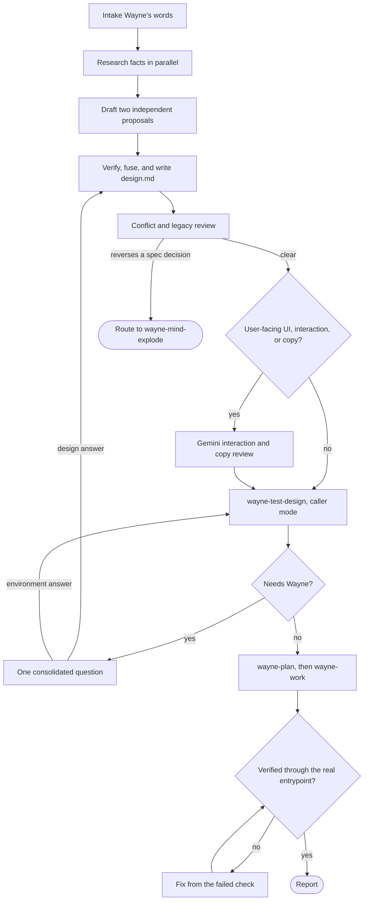

# Wayne Auto Design Task

Turn Wayne's raw request into a verified, built result. Wayne takes part only twice: he states the need, and he signs off when a gate below requires it.

## Boundary

`wayne-mind-explode` puts each design choice to Wayne and ends with an approved living spec. This skill makes those choices itself from evidence and two independent proposals, and it ends with built, verified work. Reuse mind-explode's research, decision log, conflict review, and spec contract as linked below. Do not use its question loop, its living-spec promotion, or its three-voice review.

A small task (a fix of a few dozen lines, a review finding, a copy change of a few words) needs neither skill. Do it directly. An urgent production hotfix with a confirmed root cause also skips dual-proposal design: go straight to a fast `wayne-plan` (lite path) and `wayne-work` fix.

Route to `wayne-mind-explode` and stop if any of these is true:

- Wayne asks to be questioned, or asks for an approved spec.
- The design reverses a recorded decision of a living spec in `docs/specs/`.

Hand over the run directory, both proposals, the fusion table, and `design.md`. Do not start again from zero.

## Flow

## Process

### A. Intake Wayne's words

Resolve `STATE` with `../_shared/scripts/wayne-state-dir.sh`, and use `$STATE/runs/<topic>/`. If the resolver fails, report that and stop. Record Wayne's words verbatim, with where and when he said them. Write the Pain first, as `../_shared/task-prompt.md` defines it: the symptom today, with no solution words. Every later choice must answer the Pain.

If `$STATE/runs/<topic>/context.md` is missing, run `wayne-context-init` first. Open `decision-log.jsonl` as described in mind-explode section A. If a living spec exists, continue its decision numbering.

Load [the source rationale](references/source-khazix.md) only when you need the original intent behind a gate, dual-proposal rule, or ask-first trigger.

### B. Research facts in parallel

Follow mind-explode section B, which covers the spec-freshness check, the repository, the KB, and the web. Send the independent directions to parallel subagents. Persist each settled fact as a `decision` record with numbered evidence, as in mind-explode section P. A fact that can only be observed by running something may come from a throwaway spike.

### C. Draft two independent proposals

Start Proposal A (main model) and Proposal B (read-only Gemini subagent) at the same time from the Pain, settled facts, and code.

Never give Gemini Proposal A's draft, outline, or preference: independence is the whole value of this step. If the Gemini call fails, report the failure and ask; do not rerun it on another model, and do not continue with only one proposal.

Load [Gemini brief skeletons](references/gemini-briefs.md) before dispatching Proposal B for the exact brief and model selector rule. Both proposals must cover scope, components, data and state ownership, interfaces, failure behavior, rollback, and verification; write them to `$STATE/runs/<topic>/proposal-{a,b}.md`.

### D. Verify, fuse, and write the design

Gemini writes with confidence and makes mistakes. Check every claim from B (and every `[guess]` item) against the code, logs, or production data before adopting it. When A and B disagree, evidence decides, not the author.

Send any undecidable row (both options defensible, evidence cannot separate them, and the choice changes the outcome) to G.

Load [the fusion template](references/fusion.md) before writing `$STATE/runs/<topic>/fusion.md` and appending `decision` records to `decision-log.jsonl`. The fusion table records how the design was chosen. It is not the design.

Then write the design itself to `$STATE/runs/<topic>/design.md`. Read mind-explode's [spec contract](../wayne-mind-explode/references/spec-contract.md) in full and start from its [spec template](../wayne-mind-explode/templates/spec.md), which spells the exact line formats the checker parses. Required: frontmatter; a self-contained narrative with `## Architecture` (layered, at least two `###` levels with prose), `## Interfaces`, and `## Alternatives considered` (sourced from the fusion table), plus whichever of Abstract, Background, Problem statement, Goals, Non-goals, Flows, Failure and concurrency, Observability and Rollback apply; then, below `# Appendices`, `## Requirements` (each `R<n>` with Current, Target and Acceptance), `## Verification` (every `R<n>` mapped to a proof), `## Decisions` (the taken rows of `decision-log.jsonl`), `## Technology and frameworks`, and `## Legacy` when E finds deletions or migrations. Run `uv run <skill-dir>/../wayne-mind-explode/scripts/check_spec_format.py $STATE/runs/<topic>/design.md` and `node <skill-dir>/../wayne-mind-explode/scripts/check_mermaid.mjs $STATE/runs/<topic>/design.md`, and fix what they report. `design.md` stays in the run directory: it is never written to `docs/specs/`.

When a later node changes the design (an R resolution, Wayne's answer in Q, a finding in E), update `design.md` and rerun both checkers.

### E. Conflict and legacy review

Follow mind-explode section G: re-read the existing plans, specs, and repository rules against `design.md`, and classify each spec-versus-code contradiction. If the design reverses a recorded spec decision, route to mind-explode. If the code drifted away from the spec, report it as a defect. Do not move the spec to match the code. Trace replaced functionality to its callers, and list every deletion or migration in `design.md` and the report.

### R. Gemini interaction and copy review

Use this node only for a change to user-facing UI, interaction, or copy; skip it for a change of a few words. Write your own version of the interaction and copy first, and apply Wayne's UI rule: no second label or description on a component.

Load [Gemini brief skeletons](references/gemini-briefs.md) before dispatching the Gemini review subagent. Verify each suggestion against how the feature is actually used, adopt it or reject it with a reason (rejecting unkept product promises and invented domain wording), record the resolutions in `fusion.md`, and carry the adopted ones into `design.md`.

### G. Decide whether Wayne is needed

First run `wayne-test-design` on `design.md` as its `wayne-auto-design-task` caller to produce the run's test matrix (U-SEED rows and the E2E contract traced to its `R<n>`). In that mode it takes the environment recipe from recorded sources and does not ask Wayne. When an item comes only from repository docs and the command neither writes data (no migration, seed, or reset) nor reaches anything outside the task's checkout, run it once and hand back its readiness signal or exit status; any other docs-only item stays unconfirmed. It returns every item it still could not confirm.

Wayne is needed only when one of these is true:

- **Ask-first action:** deleting data, a deploy or a production write, spend, an external message, a product-direction change, creating or rotating a credential, or a permission change.
- **New visual direction:** overall style or key visual. Show two or three mockups. Color, spacing, and style fixes are not a new direction.
- **Undecidable row from D** that changes the result.
- **Sign-off on a large design:** architecture, data storage, a long-term binding to a service, or a system-wide change of direction. A feature on the existing architecture needs no sign-off. For sign-off, show Wayne `design.md`, not the fusion table; in a TRACE repository, publish it as a static HTML TRACE Artifact page (no buttons, tabs, `
`, inputs or JS).
- **Environment gap:** `wayne-test-design` returned environment items it could not confirm.

Otherwise continue to P. Silence from Wayne is never an approval.

### Q. Ask one consolidated question

Finish every part that does not depend on the answer first. Then ask once, in plain Chinese: what is blocked and why, two or three options with your recommendation marked, and what happens after each option. Show a mockup when one can be made. Record the answer in the decision log, then return to D for the affected rows. An environment answer goes to the task context file and `wayne-test-design` instead. Whenever `design.md` changes after the matrix was written, rerun `wayne-test-design` so the matrix traces the current `R<n>`.

### P. Plan with wayne-plan, build with wayne-work

Run `wayne-plan` with `design.md` as its `origin`, this run's decision log, and the matrix from G.

The plan gets exactly one review round, and design-conformance holds it to `design.md`. wayne-plan's standard path already enforces that: one valid round, revisions applied and checked, no re-dispatch of the voices, then approval without waiting for Wayne. Do not ask for a second round, and do not add a plan review of your own. Do not write a second plan format here. If wayne-plan stops with `PLAN_CONFLICT` or `MISSING_E2E` that names the matrix, rerun `wayne-test-design` with that finding, then run `wayne-plan` again on the new matrix.

Then run `wayne-work` on the approved plan. It owns dispatch (each unit starts as soon as its dependencies are committed, with omp subagents on `isolated: true`), the per-unit audit and commit, the simplify pass, and the full-diff gate. Do not dispatch units yourself. The main model stays out of the edits.

If Wayne gives feedback during the build and it adds new scope, it is not a plan unit: do not add it to the running `wayne-work` plan. Write a lite plan as defined by [the "Mid-session feedback" rule](../_shared/task-prompt.md#sections) and dispatch its slices directly to parallel subagents, with no review. Each slice gets its own commit after the slice is verified. Start a slice only when its paths do not overlap a `wayne-work` unit that is still open.

### V. Verify through the real entrypoint

Apply the test bar in `../_shared/task-prompt.md`. Then use the result the way Wayne will use it: a page from its entry point, a CLI as a CLI. Do not report done before you see the result. When Wayne points out one miss, check all similar places the same way, and fix and report them together. PR auto-review and merge gates keep their own rules. This skill does not relax them.

### L. Report

Report in 简体中文 and lead with what was built and what Wayne will see change. Then give:

- the fusion summary: what the proposals agreed on, what came from Gemini, what was rejected and why;
- the R resolutions, if R ran;
- before and after screenshots of every UI change;
- the verification you ran.

Link `design.md` and `fusion.md` and do not paste them. Commit, push, or merge only within an authorization Wayne already gave.

## Red lines

- Gemini never sees the main model's draft before it writes proposal B.
- No claim from B enters the design unverified.
- No question to Wayne that the code, logs, data, or memory can answer.
- No edits by the main model in P. Plan units are dispatched only by `wayne-work`; only the mid-session lite plan dispatches outside it.
- No write to `docs/specs/`: that is owned by `wayne-mind-explode`. `design.md` lives only in the run directory.
