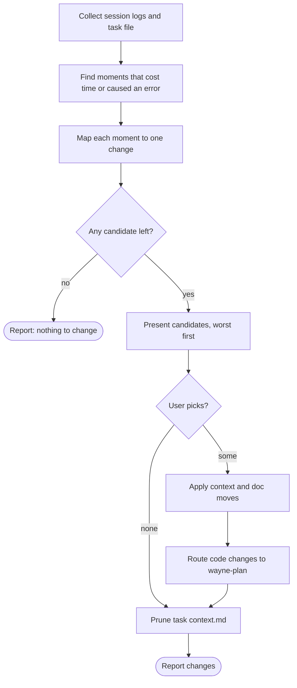

# Wayne Compress

Make the next task start from a better environment, and leave nothing behind that nobody will read.

Read [the context model](../_shared/context-model.md) first. It owns the layers, the files, and their shape.

## Flow

## Process

### A. Collect

Read the task's sessions in full: the coordinator session and every session it delegated. omp keeps them as `~/.omp/agent/sessions/<cwd-slug>/*.jsonl`; a delegated session's RESULT names its host. Also read the task file: the path the ship handoff carries, else `<state>/runs/<topic>/context.md`. If it is missing, say so in the report; the retro still runs on the logs. Read the review reports and the commit range too. If the user names no task, use the current session.

### B. Find moments

A moment is a place in a log where the agent spent many tool calls to find something, made a mistake, guessed without evidence, or was corrected. Quote each moment with its session and position. A candidate without a quoted moment is generic advice; drop it.

### C. Map each moment to one change

| What happened | Change |
| --- | --- |
| Took long to find a file or fact | a pointer in a file the agent already reads |
| Made a mistake a tool could catch | a check: lint rule, test, validator, hook |
| Made a judgment error the reviewer missed | a rule in the reviewer's standards |
| Guessed because it could not see | Run or Reach: a log, a command, an access grant |
| Needed a fact no lookup returns | a Know line in the project file or the module `CLAUDE.md` |
| Followed a rule into the wrong result | delete or fix that rule |
| A tool call cost much for what it returned | a cheaper tool or a narrower command |

Delete a rule only if it is a duplicate (name the other place), stale (what it names is gone), or misleading (a quoted moment shows harm). A rule that has not fired is not evidence; it may be the reason the mistake did not happen.

Prefer a check to a sentence: a check fails, and an agent can skip a sentence.

### E. Present

Show the candidates in Chinese, worst first, one table row each: the moment as session line numbers plus a short quote, the change, the file it lands in. Keep the whole report to one screen; the log is the evidence, so point at it instead of pasting it. Do not rank across a quiet expensive moment and a loud cheap one by noise alone; weigh the cost each one caused.

### G. Apply context and doc moves

On the user's pick, make the context-file and `CLAUDE.md` edits this skill owns. Edit only the lines the change needs.

### H. Route code changes

A check, a tool change, or a skill edit is code. Hand it to `wayne-plan` as a converged direct request through `wayne-checkpoint` handoff (`trigger: manual`). Do not write it here.

### P. Prune the task file

For each line in `<state>/runs/<topic>/context.md`:

- true beyond this task and needed by a repository reader → the module `CLAUDE.md`
- true beyond this task, Wayne-only → `<state>/context.md`
- true only for this task → delete

Then remove the task file, and remove `<state>/runs/<topic>/` if it is now empty. In `<state>/context.md`, delete a line that a newer line superseded. A line that points at something wrong (a moved file, a dead host) is a stale pointer: replace it with the correct pointer when a session moment shows the agent searched for it, and delete it otherwise.
