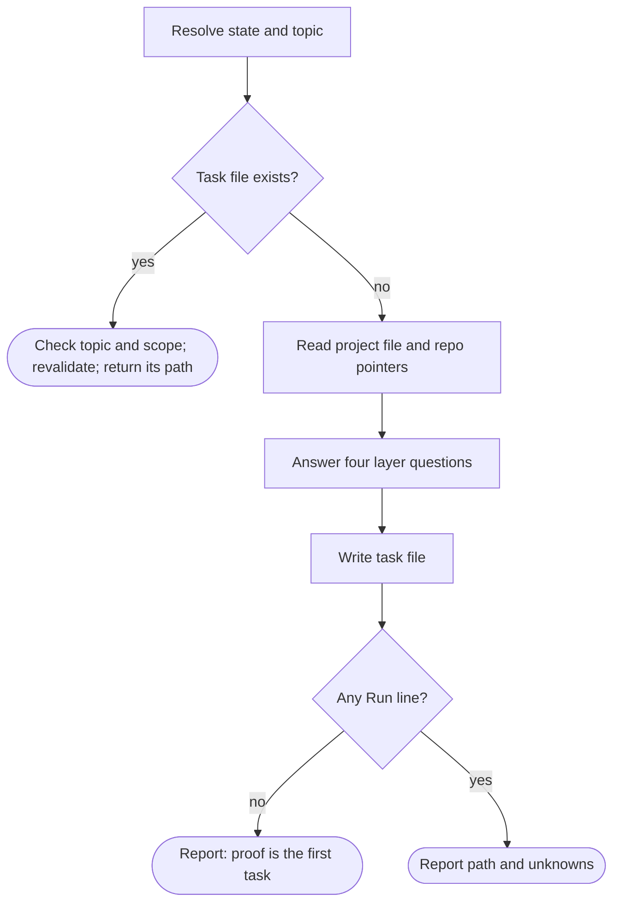

# Wayne Context Init

Give a task a context model in five minutes, before work starts, so later gaps have one place to land.

Read [the context model](../_shared/context-model.md) first. It owns the four layers, the file shape, and the writing rules.

## Flow

## Process

### A. Resolve state and topic

Resolve `<state>` with `../_shared/scripts/wayne-state-dir.sh`. If the resolver fails, report that and stop. The caller supplies the topic slug; a standalone run asks for it once.

Reuse: if `<state>/runs/<topic>/context.md` already exists, reuse it only when its Header topic and scope match this task. Revalidate volatile access (hosts, tokens, database reachability) before relying on it, or downgrade that line to `documented` or `unresolved`. Then return its path and report its `## Unknown` and `## Unreachable resources` lines.

### C. Read what already exists

Read `<state>/context.md` if it exists; if it is missing, report that and do not create it. Read `~/.wayne/CONTEXT.md` for resource locations, and the repository's root `AGENTS.md` or `CLAUDE.md` and the nearest module file for the area the task touches. Read only the pointers; follow one only when it bears on a layer question below.

### D. Answer four questions

Answer from the repository and tools first. Ask the user only for what no lookup can return, and ask all such questions in one message.

Every probe is read-only: reading files, querying a service's read endpoints, checking access. Running an existing test suite counts as a probe only after you have inspected the exact command and environment and confirmed it has no side effects on files, services, or data; otherwise record it under `## Unknown`. Do not restart, deploy, migrate, or write to any service or repository file. If a probe would need one of those, record it under `## Unknown` with the reason and who can approve it.

| Layer | Question |
| --- | --- |
| Run | Which command, on which environment, shows this task's result is right? What does a pass look like? |
| Reach | Where are the code, data, logs, and services this task touches? Can the agent read each one now? Check, do not assume. |
| Know | What does the task depend on that no lookup returns? |
| Lines | Which red lines apply beyond the global rules? |

An answer that is not true yet goes under `## Unknown`, with the layer it belongs to and who can close it. Do not invent an answer to fill a section. A required Reach resource the agent cannot read goes under `## Unreachable resources`, with its location, the reason, the impact, and the person, team, or channel to ask. That blocks only the work that depends on it; independent work continues.

### E. Write the task file

Write `<state>/runs/<topic>/context.md` in the task-file shape of [the context model](../_shared/context-model.md). Start with the Header and the retrieval boundary: link `~/.wayne/CONTEXT.md` and the repository rules, and copy nothing they already say. Link background unless leaving it out would mislead. Record each reachable resource with its exact location, access route (command or tool, never a secret value), the host it was assessed from, and its status. Use the 30–60 line soft budget; review above 80. Fill `## Questions` only with blockers, each with two or three options and a recommendation.

### G / H. Report

Report the path, every `## Unknown` line, and every `## Unreachable resources` entry with its contact, in Chinese. If no `## Run` line exists, say that building the proof is the task's first unit: an agent with no way to see right from wrong guesses, and every later step inherits the guess.
