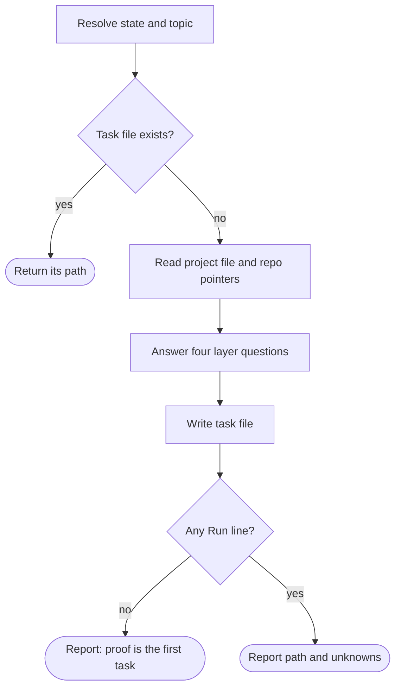

# Wayne Context Init

Give a task a context model in five minutes, before work starts, so later gaps have one place to land.

Read [the context model](../_shared/context-model.md) first. It owns the four layers, the file shape, and the writing rules.

## Flow

## Process

### A. Resolve state and topic

Resolve `<state>` with `../_shared/scripts/wayne-state-dir.sh`. If the resolver fails, report that and stop. The caller supplies the topic slug; a standalone run asks for it once.

### C. Read what already exists

Read `<state>/context.md` if it exists. Read the repository's root `AGENTS.md` or `CLAUDE.md` and the nearest module file for the area the task touches. Read only the pointers; follow one only when it bears on a layer question below.

### D. Answer four questions

Answer from the repository and tools first. Ask the user only for what no lookup can return, and ask all such questions in one message.

Every probe is read-only: reading files, running the existing test suite, querying a service's read endpoints, checking access. Do not restart, deploy, migrate, or write to any service or repository file. If a probe would need one of those, record it under `## Unknown` with the reason and who can approve it.

| Layer | Question |
| --- | --- |
| Run | Which command, on which environment, shows this task's result is right? What does a pass look like? |
| Reach | Where are the code, data, logs, and services this task touches? Can the agent read each one now? Check, do not assume. |
| Know | What does the task depend on that no lookup returns? |
| Lines | Which red lines apply beyond the global rules? |

An answer that is not true yet goes under `## Unknown`, with the layer it belongs to and who can close it. Do not invent an answer to fill a section.

### E. Write the task file

Write `<state>/runs/<topic>/context.md` in the contract's shape. Copy nothing the project file already says; the task file holds only the difference. Keep it under one screen. A longer file is a sign that facts which a lookup returns were written down.

### G / H. Report

Report the path and every `## Unknown` line in Chinese. If no `## Run` line exists, say that building the proof is the task's first unit: an agent with no way to see right from wrong guesses, and every later step inherits the guess.
