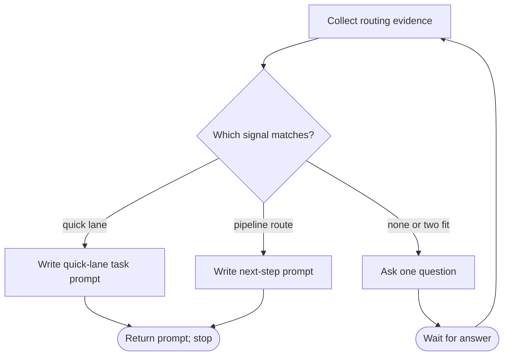

# Wayne Go

Select one route from observable evidence, write the prompt for that route, and stop. This skill never does product work and never starts a skill, session, or dispatch: the user decides who runs the prompt and where.

## Routes

| Observable signal | Route | Prompt it returns |
| --- | --- | --- |
| Small or low-stakes work with a clear target: one repository, no open design question, and nothing in the table's next note | [quick lane](references/quick-lane.md) | a complete task prompt any agent can run |
| The idea, scope, or behavior is still unsettled | `wayne-mind-explode` | next-step prompt |
| The behavior is settled and the work needs care: shared interface, several files, or a change someone else consumes | `wayne-plan` | next-step prompt (Plan takes its lite path when no decision log exists) |
| An approved plan exists for this topic | `wayne-work` | next-step prompt naming the plan path |
| Something is failing: an error, a log, a red test, an incident, an issue | `wayne-triage` | next-step prompt carrying the symptom |
| A diff is ready for review | `wayne-code-review` | next-step prompt naming the range |
| Review passed and the user wants to commit, push, or open a PR | `wayne-ship` | next-step prompt |
| The user wants to resume earlier work | `wayne-checkpoint` | next-step prompt (resume) |
| The user wants to understand an unfamiliar repository | `wayne-codebase-report` | next-step prompt |
| The user wants a long autonomous run on Codex | `wayne-goal-prompt` | next-step prompt |
| The user wants the work to run in its own tern/herdr/tmux session | `delegate-agent-session` | next-step prompt |
| none match | — | one question |

The quick lane and the pipeline routes are exclusive. Do not take the quick lane if the change touches a shared interface, a schema, or a migration, or if it alters what code that deletes data, deploys, publishes, or migrates will do. File count does not decide this: a one-line change to a deletion script is irreversible once it runs, and a quick prompt carries no plan to catch that.

## Flow



## Process

### A. Collect routing evidence

Read the raw request. If a repository is in scope, inspect it only enough to answer the table's predicates: the files the request names, whether other modules import them, whether a plan or decision log exists for the topic under `<state>/` (resolve `<state>` with `_shared/scripts/wayne-state-dir.sh`), and whether a test or run command exists. Every routing claim must trace to something you read, because a guess about size is how a shared change lands in the quick lane.

Read only. Do not edit, run the change, or diagnose past what the predicates need: the selected route owns that work.

### N. Ask one question

If no row fits, or two rows fit and the evidence cannot separate them, ask exactly one Chinese question. Lead with `我的建议：` and name one route. If the evidence favors no route, name the route the request's wording suggests most, so the user can answer with one word. Return only that question: put no findings report before it, because the user has to answer it before any finding matters. Do not write a prompt before the answer.

### Q. Write quick-lane task prompt

Read [quick lane](references/quick-lane.md) completely, then follow it.

### P. Write next-step prompt

Write one copy-paste block the user can send to start the selected skill:

```text
/<skill> <the raw request, verbatim>

Evidence from routing:
- <fact and its source path or command output>
```

Carry pointers (paths, SHAs, plan paths, error lines), not copies of files. Do not add tasks, acceptance criteria, or a design: the selected skill owns them, and a pre-filled version competes with what that skill derives.

### D. Return prompt and stop

Before the block, write one Chinese line naming the route and the fact that selected it. Return the block and stop. Do not invoke the skill, open a session, or dispatch the prompt, because the user has not chosen who runs it or where.
