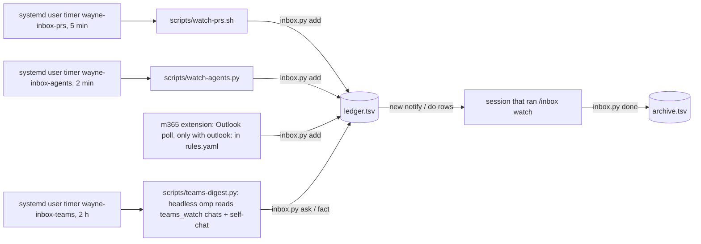

# wayne-inbox internals

How the watchers, files and timers work. Read this only to change or debug the inbox, not to handle a card.

## Files (all under `~/.wayne/inbox/`, never in a repo)

| File | Owner | What |
| --- | --- | --- |
| `rules.yaml` | Wayne (hand-written); `teams_watch` by the m365 extension; `agent_watch` by `inbox.py agent` | classification rules per source/place, the Teams watches to resume, the agent sessions to watch |
| `ledger.tsv` | `scripts/inbox.py` | live rows only: `open` or `claimed` |
| `archive.tsv` | `scripts/inbox.py done` | finished rows (`state` = `done`); keeps their keys so an event is never recorded twice |
| `cursors/github-prs.since` | `scripts/watch-prs.sh` | last PR scan time |
| `cursors/teams-digest.since` | `scripts/teams-digest.py` | last Teams read; moves only after every finding is recorded |
| `cursors/session-push.id` | m365 extension | highest ledger id already pushed to the session |
| `cursors/outlook-inbox.since` | m365 extension | last mail recorded (only when `outlook:` exists in rules.yaml) |
| `cursors/agent-watch.json` | `scripts/watch-agents.py` | per watched session: last activity, pane text hash (run state, not config); `_digest.at`: when the last progress digest was sent |
| `cursors/trace-monitor.posted.json` | `scripts/trace-monitor.py` | finding keys already posted to Teams; written only after a successful `--post` |
| `cursors/trace-monitor.verdicts.json` | `scripts/trace-monitor.py` | magpie verdict cache (finding key + hash of the judged text), so reruns do not call the model again |

`templates/rules.yaml` is a mock example. Never copy real chat ids, PR numbers or people into it.

## Flow



`wayne-inbox-trace-monitor` (systemd user timer, 30 min) runs `scripts/trace-monitor.py --post` outside the ledger: it reads TRACE prod Postgres read-only over the jumpbox (window: the last `--days`, default 2), has a small magpie model (`--model`, `TRACE_MONITOR_MODEL`) judge Captain replies and needs_attention texts, adds TRACE-side failures from `run_reviews` and personal Captain chats silent for 7 days, and posts one digest of findings not posted before (one line per TRACE task) to the TRACE group through headless omp `teams_send`. A run counts as sent only on a `teams_send` receipt in omp's `--mode json` output; only then are the keys added to `trace-monitor.posted.json`. Without `--post` it is a dry run that prints the digest; `--target self` sends to the self-chat; `--calibrate` checks the judge on the three calibration cases. To stop posting, drop `--post` from the unit's ExecStart and `systemctl --user daemon-reload`. Tests: `cd scripts && uv run --with pytest --with click --with loguru --with httpx pytest -q test_trace_monitor.py`.

- `rules.yaml`: `source -> place -> [rules]`, first match wins. `when` is exact match (list = any, `"!x"` = not x). `action`: `do` (card starts a turn), `notify` (card shown, waits for Wayne), `log` (ledger only, not pushed), `ignore` (not recorded). A place with no rules is not recorded.
- GitHub fields: `number`, `event` (`review | check | merged`), `state`. To watch a PR, add its number to the `number` lists of that repo; to stop, remove it.
- A place may be `"*"`: the source's rules for any place with none of its own (agent sessions are named at run time).
- One session delivers at a time (abstract-socket lease per inbox directory). It ends with the session.

## Commands

```bash
I="uv run --quiet $WAYNE_SKILLS_DIR/wayne-inbox/scripts/inbox.py"
$I ls                                   # live rows (open + claimed)
$I set <id> --state claimed --owner <who>
$I done <id>... --note <outcome>        # finished: out of the ledger, into archive.tsv
$I add --source github --place <repo> --key <k> --subject <s> --field k=v ...   # what the watchers call
$I ask "<question>" --key <k> --note <where>   # someone waits for Wayne: ask-wayne notify row
$I fact "<decision or rule>" --key <k> --note <chat, who, time>   # teams-fact log row
```

In omp: `/inbox watch` (deliver here), `/inbox stop`, `/inbox status`.

## Agent sessions

To start one, use the `delegate-agent-session` skill: it writes the brief, launches omp in tern, herdr or tmux (local or an ssh host), and registers the session here. Every agent session Wayne or an agent wants followed goes on the `agent_watch` list:

```bash
$I agent add <name> --mux tern|herdr|tmux --pane <tern block id | herdr agent | tmux target> \
  [--host <ssh host>] --result <deliverable file with the RESULT block> --goal "<one line>"
$I agent ls
$I agent rm <name>...
```

`tern new session …` prints the block id; `delegate-agent-session` lists the pane id for each multiplexer. `watch-agents.py` checks each one every 2 minutes, where it lives (one ssh call for a remote host), and looks at only three things:

| Look | How | Event (source `agents`, place = name) |
| --- | --- | --- |
| start: still there | `tern process` / `herdr agent get` / `tmux display -p` | `gone exited`: pane ended with no RESULT |
| end: RESULT written | `status:` line in the `--result` file | `result done/partial/blocked`, once per write |
| middle: still producing | omp: session jsonl mtime (open in `/proc/<pid>/fd`); herdr: its agent state; else pane text changed | `stalled quiet` after 30 min without output, once per quiet spell; herdr `blocked waiting` |
| idle without RESULT | omp: last jsonl message a finished assistant turn; herdr: `idle`/`done` | `idle no-result`, once per idle spell: the agent stopped without writing its RESULT (forgot, or asked a question in prose) |

`tern capture` gives nothing for omp panes, which is why the jsonl is the activity signal. A session whose RESULT says `done` is dropped from the list after its event; the others stay until `agent rm`.

Every `--digest-min` minutes (default 30) the same run also sends one progress digest to Wayne's self-chat: one line per watched session still running, `name · host · last activity HH:MM · <newest assistant text [todo done/total, now: …]>` (non-omp panes: the last pane line). A failed probe shows as `probe failed: <cause>` on its own line. Nothing running → no message. The digest never writes inbox rows. A failed send is logged at ERROR, exits 1, and is retried on the next due run.

The default rules make `result` and `idle` rows `do`: the card starts a turn in the coordinator session. On `result`, verify the claims at the source, report in the channel `--goal` names (Teams, self-chat), then `done`. On `idle`, read the session's last message: if the job is finished, send it one line asking for the RESULT block in the deliverable file; if it asked a question, relay the question to Wayne.

## Resume after a restart

1. `/inbox watch` in the new session. Agent sessions need nothing: the timer watches them whatever session runs.
2. Read the `teams_watch` section of `~/.wayne/inbox/rules.yaml`. For each chat call `teams_watch` with `action: start`, its `chat_id` and `policy`; pass `interval_sec` on the first call.
3. Report what is watched. Do not invent chats or policies that are not in the file.

The extension rewrites `teams_watch` on every explicit start, stop and interval change (never on session end), so the list is current. It rewrites only that section, kept last in the file; the hand-written rules above it stay byte for byte.

To restart omp itself from inside a Tern pane: a detached script sends `TERM` to the omp process, then `tern run $TERN_PANE 'omp --resume <session-id>'`, then types `/inbox watch` and a prompt asking the new session to do step 2.
