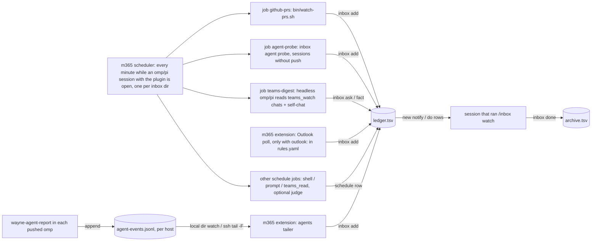

# wayne-inbox internals

How the watchers, files and jobs work. Read this only to change or debug the inbox, not to handle a card.

The inbox itself (CLI, scheduler, PR watch, agent probe, Teams digest job, card delivery) is the m365 plugin's `inbox/` (`pi-config/extensions/m365/`, see its README). This skill keeps what is Wayne's: the role, his `rules.yaml`, his card note, and `trace-monitor`.

## Files (all under `~/.wayne/inbox/`, never in a repo)

| File | Owner | What |
| --- | --- | --- |
| `rules.yaml` | Wayne (hand-written; `inbox setup` creates it from the plugin's `inbox/templates/rules.yaml` when missing); `teams_watch` by the m365 extension; `agent_watch` by `inbox agent`; `schedule` by `inbox schedule` and the scheduler (`next_fire`, `last`, `last_ok`) | classification rules per source/place, the Teams watches to resume, the agent sessions to watch, the scheduled jobs |
| `ledger.tsv` | `inbox` CLI | live rows only: `open` or `claimed` |
| `archive.tsv` | `inbox done` | finished rows (`state` = `done`); keeps their keys so an event is never recorded twice |
| `cursors/github-prs.since` | plugin `bin/watch-prs.sh` (job `github-prs`) | last PR scan time |
| `cursors/schedule-<job>-<fire>.claim` | scheduler | one fire claimed, so two runners never run it twice; stale after 15 min (or the job's timeout + 1 min) |
| `thens.json` | `inbox then` / `then-done`; the scheduler marks `fired` / `reminded` | deferred actions: row, trigger, action, when added, which ledger id was newest then (an `agent-result` trigger only counts a later RESULT row) |
| `card-note.md` | Wayne (copy of `templates/card-note.md` in this skill) | the standing note said on every inbox and Teams watch card; no file, no note |
| `cursors/session-push.id` | m365 extension | highest ledger id already pushed to the session |
| `cursors/outlook-inbox.since` | m365 extension | last mail recorded (only when `outlook:` exists in rules.yaml) |
| `cursors/agent-watch.json` | `inbox agent probe` (job `agent-probe`) | per watched session: last activity, pane text hash (run state, not config); `_digest.at`: when the last progress digest was sent |
| `agent-events.jsonl` | `wayne-agent-report` extension in each pushed omp session (on the host it runs on) | one JSON line per state change: `started`, `working` (`prompted`: whether a submitted prompt started the turn), `ask`, `ask-resolved`, `idle`, `result`, `ended`, `hb` (heartbeat, 60 s); append-only, the durable queue |
| `cursors/agent-events.json` | m365 extension | per host: byte offset and inode already read from `agent-events.jsonl`; per pushed session: last event, last seen, pid |
| `cursors/trace-monitor.posted.json` | `scripts/trace-monitor.py` | finding keys already posted to Teams; written only after a successful `--post` |
| `cursors/trace-monitor.verdicts.json` | `scripts/trace-monitor.py` | magpie verdict cache (finding key + hash of the judged text), so reruns do not call the model again |

The plugin's `inbox/templates/rules.yaml` is a mock example. Never copy real chat ids, PR numbers or people into it.

## Flow



`wayne-inbox-trace-monitor` (systemd user timer, 30 min) runs `scripts/trace-monitor.py --post` outside the ledger: it reads TRACE prod Postgres read-only through `TRACE_MONITOR_PROD_CMD` (window: the last `--days`, default 2), has a small magpie model (`--model`, `TRACE_MONITOR_MODEL`) judge Captain replies and needs_attention texts, adds TRACE-side failures from `run_reviews` and personal Captain chats silent for 7 days, and posts one digest of findings not posted before (one line per TRACE task) to the TRACE group (`TRACE_MONITOR_GROUP_CHAT`) through headless omp `teams_send`. A run counts as sent only on a `teams_send` receipt in omp's `--mode json` output; only then are the keys added to `trace-monitor.posted.json`. Without `--post` it is a dry run that prints the digest; `--target self` sends to the self-chat; `--calibrate` checks the judge on the three calibration cases. To stop posting, drop `--post` from the unit's ExecStart and `systemctl --user daemon-reload`. Tests: `cd scripts && uv run --with pytest --with click --with loguru --with httpx pytest -q test_trace_monitor.py`.

Site values are not in the repo; the unit sets them as environment variables (a drop-in under `~/.config/systemd/user/wayne-inbox-trace-monitor.service.d/`). A missing one stops the run before any prod query:

| Variable | Flag | Value |
| --- | --- | --- |
| `TRACE_MONITOR_PROD_CMD` | `--prod-cmd` | a local command that runs its stdin as bash on the TRACE prod host and prints the output; how it reaches the host and authenticates lives only in that local script |
| `TRACE_MONITOR_TRACE_URL` | `--trace-url` | TRACE dashboard base URL (`<url>/tasks/<id>` links) |
| `TRACE_MONITOR_JIRA_URL` | `--jira-url` | Jira base URL (`<url>/browse/<ticket>` links) |
| `TRACE_MONITOR_GROUP_CHAT` | `--group-chat` | Teams chat id of the TRACE group; needed for `--post --target group` |
| `TRACE_MONITOR_RULES` | `--rules-file` | handling-rules markdown; needed for `--preprocess` (`TRACE_MONITOR_PREPROCESS=1`) |

`watch-prs.sh` with no arguments watches the repos listed under `github:` in `rules.yaml` (`inbox places github`); none listed is an error. The `github-prs` job runs it (needs `gh` and `jq`). It records new reviews, completed checks and merges of your PRs. A review or PR comment whose body contains `Multi-source auto-review` (the TRACE auto-review, posted from your own login) is recorded as `event=review actor=auto-review`, keyed `…:review:<id>` or `…:comment:<id>`; other PR comments are not read.

- `rules.yaml`: `source -> place -> [rules]`, first match wins. `when` is exact match (list = any, `"!x"` = not x). `action`: `do` (card starts a turn), `notify` (card shown, waits for Wayne), `log` (ledger only, not pushed), `ignore` (not recorded). A place with no rules is not recorded.
- GitHub fields: `number`, `event` (`review | check | merged`), `state`, `actor` (reviewer login, or `auto-review`; review only), `verdict` (`clean` when the body says "no critical", up to two words between, e.g. "No new CRITICAL issues", has no CRITICAL heading or item, and no line says findings are still open, present or unresolved; else `critical`; the rule is in the plugin's `bin/auto-review.sh`) and `commit` (the reviewed sha, up to 9 characters, when the body names one) on auto-reviews. Put the `actor: auto-review` rule above an `actor: <your login>` ignore rule. To watch a PR, add its number to the `number` lists of that repo; to stop, remove it.
- A place may be `"*"`: the source's rules for any place with none of its own (agent sessions are named at run time).
- One session delivers at a time (abstract-socket lease per inbox directory). It ends with the session.

## Commands

```bash
I="$WAYNE_SKILLS_DIR/pi-config/extensions/m365/bin/inbox"   # plain node >= 22; the plugin calls the same code in-process
$I setup                                # rules.yaml from the template if missing, cursors, first fires; fails naming a missing tool
$I ls                                   # live rows (open + claimed)
$I set <id> --state claimed --owner <who>
$I done <id>... --note <outcome>        # finished: out of the ledger, into archive.tsv
$I add --source github --place <repo> --key <k> --subject <s> --field k=v ...   # what the watchers call
$I ask "<question>" --key <k> --note <where>   # someone waits for Wayne: ask-wayne notify row
$I fact "<decision or rule>" --key <k> --note <chat, who, time>   # teams-fact log row
$I schedule add <name> --every <min> | --cron '<m h dom mon dow>' --kind shell|prompt|tool --action <argv JSON | text | {name,args}> [--judge on --judge-prompt …] [--quiet] [--timeout s] [--tools a,b] [--disabled]
$I schedule ls | rm | enable | disable | run --due | run --job <name>
$I then <id> --when <trigger> -- <action>   # deferred action on a live row (see Then-actions)
$I then-done <id> <n> [--note <why>]
$I done <id> --force --note <why>       # also closes the row's fired, open then-actions
```

In omp or pi: `/inbox setup`, `/inbox watch` (deliver here), `/inbox stop`, `/inbox status` (where the scheduler runs, each job's next fire and last result, the open rows).

## Jobs

The scheduler runs in the plugin, not in systemd: every minute, in the first omp or pi session on this inbox directory that holds the scheduler lease (any session with the plugin, `/inbox watch` or not). Nothing runs while no such session is open; a missed fire runs once at the next tick. The tick does not wait for its jobs: a job still running (a 15-minute digest) is skipped by later ticks, which keep running the other due jobs and the then-actions. A shell job's argv has the plugin's `bin/` first on PATH, so `inbox`, `watch-prs.sh` and `pr-ready.sh` resolve. A prompt job runs `omp -p` (else `pi -p`, or `INBOX_AGENT`) in the inbox directory, `{{since}}` replaced by the last successful run (24 h ago at first). A `quiet` job records no row when it succeeds (it writes its own rows); a failure always records a `notify` row. A judged job's output goes to a small model (omp: the `tiny` role; pi: the session model) that answers INJECT or SKIP.

## Then-actions

`inbox then <id> --when <trigger> -- <action>` hangs a follow-up on a live row. Triggers: `pr-merged:<owner/repo>#<n>` (the PR watch's `github:<repo>#<n>:merged` row exists), `gh-run:<owner/repo>:<run-id>` (`gh run view` says completed), `agent-result:<name>` (a RESULT row for that agent newer than the then), `at:<YYYY-MM-DD HH:MM>`. The delivering session checks on every inbox change; the scheduler tick also checks `gh-run`, `at:` and reminders. A trigger makes one `do` row (`then` tag, owner `coordinator`): "Trigger X happened; you owe: <action>". Still open 10 minutes later: one reminder row. `inbox then-done <id> <n>` closes it; `inbox done <id>` refuses while a fired one is open (`--force --note` overrides). An unfired then stays armed after its row is done. `inbox ls` and `/inbox status` list the open ones.

## Agent sessions

To start one, use the `delegate-agent-session` skill: it writes the brief, launches omp in tern, herdr or tmux (local or an ssh host), and registers the session here. Every agent session Wayne or an agent wants followed goes on the `agent_watch` list:

```bash
$I agent add <name> --mux tern|herdr|tmux --pane <tern block id | herdr agent | tmux target> \
  [--host <ssh host>] [--result <deliverable file with the RESULT block>] [--goal "<one line>"] \
  --row <live row id> --then "<plan for its RESULT: expected outcome, whom to reply to and how, what to close>" [--push]
$I agent ls                              # last column: push
$I agent rm <name>...
```

`--row` and `--then` are required. `--row`/`--then` arm an `agent-result:<name>` then on that row (see thens): the next RESULT fires a card quoting the plan, and `done` of the row refuses until the then is closed. Adding the same name again replaces the registration and cancels its previous unfired then.

An entry is watched one of two ways, decided only by its registration.

### Pushed (`--push`): the session reports itself

The omp session was launched with `WAYNE_AGENT_WATCH=<name>` and `WAYNE_AGENT_RESULT=<deliverable>` (`delegate-agent-session` step 3). Its `wayne-agent-report` extension (`omp-config/extensions/wayne-agent-report.ts`, linked into `~/.omp/agent/extensions/`) deletes both variables at load, so nested `omp -p` runs and subagents do not report, and appends one line per state change of its root session to `agent-events.jsonl` on its own host.

The session running `/inbox watch` tails that file: the local one on every inbox-directory change; for each remote `--host` one long-lived `ssh -o ServerAliveInterval=30 <host> tail -c +<offset+1> -F agent-events.jsonl`, reconnected after it exits (5 s doubling to 60 s) from the stored offset. No timer is involved in delivery.

| Pushed event | Row (source `agents`, place = name) | Default rule |
| --- | --- | --- |
| `ask` (the `ask` tool or a tool approval is pending) | `event=ask state=ask\|approval`, note = question and options | `do` |
| `result` (turn ended, RESULT has a status line) | `event=result state=<status>`, note = last output; `done` also runs `agent rm` | `do` |
| `idle` (turn ended, no RESULT status) | `event=idle state=no-result`, note = last output | `do` |
| `ended` (omp exited) | `event=ended state=exited` | `do` |
| `dead` (made up by the tailer) | `event=dead state=no-heartbeat\|never-started` | `do` |
| `started`, `working`, `ask-resolved`, `hb` | none: run state and the status row only | |

`dead` exists only to catch a dead process: no event (the heartbeat is every 60 s) for `WAYNE_AGENT_DEAD_SEC` (300 s) while the host's stream has been up for longer than that window, so a network outage never reads as a death; `never-started` means the name was registered but its reporter never wrote (env not set at launch, or the extension not linked on that host). One row per silence (key `agents:<name>:dead:<lastSeen>`). Events that arrive before the name is registered (the pane id is known only after launch) are held and recorded once `agent add --push` runs. After `result done` retires a name, its session's later events are its finished run settling and exiting and make no rows, unless a prompt starts a new turn in that session (a follow-up; its `working` event is not marked `prompted: false`): those are held like any unregistered events and delivered when the name is registered again. A turn an extension starts (an advisor message, `prompted: false`) is the finished round going on: its `result done` is dropped with a warning, never a card, so it cannot retire the name again on re-registration. A reporter without `prompted` (sessions launched before it) cannot mark that turn; then the first result held for the re-registration is dropped, with a warning, when it repeats the retiring `result done` (same status and open items) and nothing (ask, idle) came between. Events held for a name that is not registered within a day are dropped with a warning. A new session under the name ends the old one's claim for good. The status row shows `◉inbox · <n> agents` and a link that is down; `/inbox status` lists each host's offset and each session's last event.

`inbox agent probe` does not probe pushed entries for events; it still gives them a line in the progress digest.

### Probed (no `--push`): the agent-probe job looks

`tern new session …` prints the block id; `delegate-agent-session` lists the pane id for each multiplexer. The `agent-probe` job (`inbox agent probe`) checks each one every 2 minutes, where it lives (one ssh call for a remote host), and looks at only three things:

| Look | How | Event (source `agents`, place = name) |
| --- | --- | --- |
| start: still there | `tern process` / `herdr agent get` / `tmux display -p` | `gone exited`: pane ended with no RESULT |
| end: RESULT written | `status:` line in the `--result` file | `result done/partial/blocked`, once per write |
| middle: still producing | omp: session jsonl mtime (open in `/proc/<pid>/fd`); herdr: its agent state; else pane text changed | `stalled quiet` after 30 min without output, once per quiet spell; `blocked waiting` when herdr/hc say blocked or the omp jsonl's last message is a pending `ask` tool call (never `stalled` then) |
| idle without RESULT | omp: last jsonl message a finished assistant turn; herdr: `idle`/`done` | `idle no-result`, once per idle spell: the agent stopped without writing its RESULT (forgot, or asked a question in prose) |

`tern capture` gives nothing for omp panes, which is why the jsonl is the activity signal. A session whose RESULT says `done` is dropped from the list after its event; the others stay until `agent rm`.

Every `--digest-min` minutes (default 30) the same run also sends one progress digest to Wayne's self-chat, as `teams_send`'s progress card (`agents`): one row per watched session still running whose entry changed since the last digest sent, pushed or probed: name, host, idle minutes, status (`working`, `waiting on question` for a blocked or idle pane or a non-done RESULT, `done`, `probe failed`), and the newest assistant text `[todo done/total, now: …]` (non-omp panes: the last pane line) behind a tap; sessions that need Wayne come first. The entry compared is the status plus `name · host · <text>` (the last-activity time does not count), so a session turning to `waiting on question` with the same text is still sent; the last entry sent is `digested` in the session's state. A card counts as sent only on the `Sent a card to self-chat (48:notes).` receipt with the card arguments verbatim; a refused card is logged and the same digest goes out as text (`name · host · last activity HH:MM · <text>` lines). Nothing running or nothing changed → no message. The digest never writes inbox rows. A failed send (card and text both) fails the run and is retried on the next due run.

Pushed sessions get the same rule as cards: the tailer skips a row whose question and options, RESULT status and `open:` line, or idle output match the last row added for that name (logged as `repeats the last card; not added`). `ended` and `dead` always go out.

The default rules make `result`, `idle`, `ask`, `ended` and `dead` rows `do`: the card starts a turn in the coordinator session. On `result`, verify the claims at the source, report in the channel `--goal` names (Teams, self-chat), then `done`. On `idle`, read the card's last output: if the job is finished, send the session one line asking for the RESULT block in the deliverable file. A question or blocker (on `ask`, in RESULT `open:`, or at the end of an idle turn) is the coordinator's first: answer it with tools when they can (read-only prod config check, repo fact, a decision Wayne already made) and send the answer into the session; ask Wayne only what needs his decision, as one concrete question in plain Chinese with what is blocked and why, 2–3 options with a recommendation, and what happens after each. `gone`, `stalled` and `blocked` (probed only) are `notify`.

## Resume after a restart

1. `/inbox watch` in the new session. Agent sessions need nothing more: probed ones are watched by the `agent-probe` job in whichever session holds the scheduler; pushed ones resume from `cursors/agent-events.json`, and every event written while no session delivered arrives once in the first batch.
2. Read the `teams_watch` section of `~/.wayne/inbox/rules.yaml`. For each chat call `teams_watch` with `action: start`, its `chat_id` and `policy`; pass `interval_sec` on the first call.
3. Report what is watched. Do not invent chats or policies that are not in the file.

The extension rewrites `teams_watch` on every explicit start, stop and interval change (never on session end), so the list is current. It rewrites only that section, kept last in the file; the hand-written rules above it stay byte for byte.

To restart omp itself from inside a Tern pane: a detached script sends `TERM` to the omp process, then `tern run $TERN_PANE 'omp --resume <session-id>'`, then types `/inbox watch` and a prompt asking the new session to do step 2.
