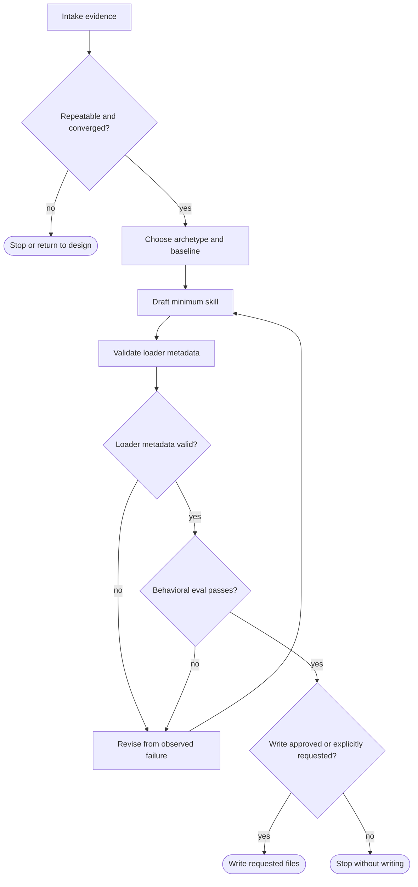

# Wayne Skill Forge

Turn one repeatable pattern into the smallest skill that reliably changes agent behavior.

## Boundary

`wayne-distill` supplies evidence. `wayne-mind-explode` converges raw ideas. This forge owns Wayne skill authoring, loader metadata, and behavioral eval. Do not forge a one-off, an unconverged idea, or guidance that global `AGENTS.md` / `CLAUDE.md` already owns.

Every skill is one kebab-case directory that contains `SKILL.md`. The YAML frontmatter requires `name` and `description` and uses only loader-supported keys. The `name` value matches the directory name. The `description` owns all triggering language. Add only the resources that the runtime needs:

- repeated operational work in `scripts/`
- conditional knowledge in one-level `references/`
- output material in `assets/` or `templates/`

### Start from the strongest-model baseline

Assume that the model already knows general software practice, reasoning, code review, planning, and tool use. Add a line only if it carries at least one of these items:

- a local fact, schema, path, command, ownership rule, or approval boundary
- a repeatable workflow that the base model does not reliably reproduce
- an observed failure and the smallest instruction that prevents it
- an output contract or verification gate whose omission breaks the task

If no evidence or local fact justifies a line, cut it. Do not encode generic advice such as “read first”, “think carefully”, “follow existing patterns”, or “run tests”.

### Keep one owner for every instruction

- Put durable repository behavior in `AGENTS.md` / `CLAUDE.md`, not in each skill.
- Put routing terms in the frontmatter `description`, not in a body “When to Run” section.
- Put control flow in the Flowchart. Expand node details below it, and do not restate edges.
- Put detailed schemas, variants, examples, and long checklists in one-level references.
- Put repeated or deterministic operations in scripts. Execute the scripts instead of rewriting them.
- Keep each fact in the body or in a resource, never in both.

### Use lean defaults

| Surface         |                 Target |             Hard boundary |
| --------------- | ---------------------: | ------------------------: |
| `description`   |     180–400 characters |          1,024 characters |
| `SKILL.md`      |        800–1,500 words |    fewer than 4,000 words |
| reference       |      one focused topic | add a TOC above 800 words |
| reference depth | direct from `SKILL.md` | no nested reference chain |

Budgets are in words, never lines. A line count measures how the file was wrapped, not how much an agent has to read, and this repository writes one line per paragraph.

Exceed a target only if a behavioral eval shows that the additional context prevents a real failure. Size reduction alone is not success. Behavior must stay correct.

Match the form of a fix to the failure:

- skipped rule → gate plus reason
- wrong shape → example
- omitted information → explicit instruction
- conditional behavior → predicate
- repeated fragile logic → script

Add an anti-pattern only for an observed mistake.

### Protect the contract before compressing

Build a temporary requirement coverage map. The map links every approved requirement to exactly one owner: the body, a reference, a template, or the eval. Do not start compression until the map has no orphan requirement. Do not ship the map.

If an upstream source or a real machine consumer makes the exact bytes of a quoted literal normative, preserve the literal. Otherwise, do not invent exactness for an AI-readable document. If an actual parser, API, loader, or executable consumes the output, read [contract protection](references/contract-protection.md). For an AI-to-AI Markdown handoff, use semantic ownership and behavioral review, not a fabricated schema and validator pair.

Compression is two operations in this order: **move**, then **cut**. First, move material:

- Move long, branch-conditional detail that has evidence behind it into `references/`.
- Move repeated deterministic operations into `scripts/`.
- Move output material into `templates/`.
- Keep repeated control flow that still needs judgment or branching in the Flowchart and the body. A script would move the decision away from the agent that must make it.

Only content that none of these moves can take is a cut candidate. The `SKILL.md` budget bounds always-loaded context, not the knowledge that the skill is allowed to carry. Treating overflow as deletion is how a skill loses what it was built to know.

A reference is **optionally loaded, never optionally correct**. Moving material does not make it advisory. For each reference, the body keeps the load condition and a direct link. The reader must be able to tell when the reference is required without opening it.

Then cut in this order: decoration → copied global rules → generic advice → redundant examples → duplicated explanation. Do not cut any of these items only to meet a size target: an approval or stop gate, a state owner, an input or output contract, a retry or error semantic, a cross-record invariant, or a verification proof.

## Archetypes

| Archetype | Use when | Core | Template |
| --- | --- | --- | --- |
| **Procedure** | order, gates, or retries matter | branching Flowchart; node-aligned process | [procedure](templates/skill-template-procedure.md) |
| **Lens** | value is judgment across varied cases | applicability; reasons; contrasting cases | [lens](templates/skill-template-lens.md) |
| **Router** | ≥3 playbooks selected by signals | table; Flowchart; direct references; no-match | [router](templates/skill-template-router.md) |

If a router has fewer than three playbooks, use a procedure with a branch. If a procedure has no meaningful branch, omit the Flowchart and keep one numbered process.

## Flowchart contract

The Flowchart is the Wayne control-flow language. If the skill has a decision, loop, route, retry, approval gate, or more than one terminal state, add a Flowchart. The Flowchart owns sequence and branching. The Process sections own node inputs, actions, outputs, and verification.

- Use a `mermaid` fence with `flowchart TB` (or `LR`) and stable node IDs (`A`, `B`, `C`) with short quoted labels.
- Use `["action"]` for action, `{"decision"}` for decision, and `(["terminal"])` for terminal.
- Use only native Mermaid shapes. Do not use `style`, `classDef`, `linkStyle`, `%%{init}%%`, or theming. Without them, the diagram renders the same in any Markdown viewer.
- Label every outgoing decision edge. Include the no-match or failure path.
- Keep commands, schemas, and explanations out of node labels.
- Match process headings to action node IDs, such as `### D. Draft`.
- Do not maintain a second checklist that restates the same sequence.
- Keep one main Flowchart in each skill. Move a mode-specific Flowchart to a direct reference.

## Flow



## Process

### A. Intake evidence

Collect these items:

- the user phrases that must trigger the skill, and the phrases that must not trigger it
- the local facts and hard constraints that the model cannot infer
- the baseline failures that the skill must correct
- the closest existing skill, and the reason that the new skill is not an extension of it

If the skill already exists, keep its current files as the A/B control.

### B. Confirm it earns a skill

Require recurrence, a costly failure, or specialized local knowledge. If the idea still changes, return it to design. If a global owner already owns the rule, update that owner instead. Start the requirement coverage map. If two clauses define different accepted outputs and no precedence resolves them, stop. Return the exact conflict upstream. Do not pick the more convenient clause.

### C. Choose archetype and baseline

Choose the archetype from the observable shape of the task. Before you draft, define the eval baseline:

- new skill: the strongest model without the skill
- existing skill: the current skill versus the candidate
- trigger change: the current metadata versus the candidate metadata

Use the same model, reasoning effort, tools, task, and input artifacts on both sides. If the change is a revision, create or reuse the versioned harness at `eval/<skill-name>/` before you draft. A `/tmp`-only evaluator is not durable evidence.

### D. Draft the minimum skill

Start from the archetype template. Write the discovery metadata first. Then write only the core workflow or judgment. Put conditional detail in resources. Use direct, conclusion-first language. Do not copy persona blocks or global invariant blocks. If the skill has a Flowchart, expand its node IDs and do not duplicate its sequence. Complete the requirement coverage map before you cut anything.

Before you draft or revise skill prose, read [instruction prose](references/instruction-prose.md). Follow its rules for each sentence by function: instruction or rationale. The rules adapt ASD-STE100 sentence rules to skill prose.

Before you declare the draft done, extend the coverage map into a resource placement decision. Name the owner of every piece of detail material: the body, a one-level reference in `references/`, a script in `scripts/`, or a template in `templates/`.

If material is both branch-conditional and long, move it to a reference. Such material includes schemas, variant tables, worked examples, full command recipes, and per-case checklists. The body then keeps the gate itself and a direct link that says when to load the reference. Keep short gates, verify conditions, and single commands inline. If nothing qualifies, record `No reference: <reason>`. Keep this decision in the working map and in the eval evidence, never in the shipped skill.

This rule prevents a real default failure. The forge states the pressure to cut explicitly and repeats it, but the permission to add a resource is passive. As a result, conditional detail gets inlined or silently dropped.

For any proposed runtime schema or validator, name the non-AI consumer that parses it and the failure that it prevents. If the next consumer is an agent that reads Markdown, reject the mechanism. Use source-grounded AI review and behavioral eval instead. Regex, headings, keywords, counts, templates, and similarity may be evaluator observations. They never become a prose correctness gate by themselves.

### E. Validate loader metadata and formatting

```bash
uv run <wayne-skill-forge-dir>/scripts/validate_skill.py <skill-directory>
npx prettier --check <skill-directory>
```

The validator checks only the loader-level metadata that the official skill creator expects. It does not judge Markdown organization, Flowchart style, prose, or behavior. Run every bundled operational script on its real job. Check each result against that job. If the environment prevents execution, report the proof as incomplete.

`prettier --check` enforces the `.prettierrc` of the repository: one line for each paragraph and no hard wrapping. If the check fails, fix it with `--write`, not by hand. Hard-wrapped prose is the default that an LLM writes, and nobody chose it here. With hard wrapping, a one-word change reflows a whole paragraph, and one sentence spans three edit anchors.

### F. Run behavioral eval

Follow [the eval protocol](references/eval.md):

- Freeze the repository harness before you generate the candidate.
- An observed failure earns an anti-pattern only if the control fails its exact case and the candidate passes it.
- Use at least three representative cases. If the skill is trigger-sensitive or high-risk, use five or more.
- Run the control and the candidate in fresh contexts. Do not reveal the expected fix.
- Score success, boundaries, output, Flowchart, context, and resource discovery.
- Accept the candidate only if it has no regression in required behavior. If the control and the candidate behave the same, prefer the smaller one.
- Turn each failure into one minimal instruction, resource, or operational script.
- Use deterministic checks only for a real machine-consumed interface. Use an independent AI semantic judge for agent-readable artifacts.
- Keep invalid artifacts as evidence. Do not repair them by hand.
- Freeze eval observations before generation. Give their results to the blind AI judge as evidence, not as an automatic semantic verdict.
- Trace every finding to a published intent or task clause. If an expectation has no such trace, the evaluator is invalid, not the candidate.
- If a provider error, timeout, or tool-use termination stops a trial before an observable result, mark the trial invalid. An invalid trial is not a loss.

If you evaluate this forge, run the meta-eval. The control forge and the candidate forge each generate a child skill from the same evidence. Then fresh downstream agents use the child skills on identical real tasks. Judge the downstream execution, not the prose quality of the generated `SKILL.md`.

### G. Gate and write

Show the files and the eval result in plain Chinese. Write only after approval. An explicit request for the edit counts as approval. Recheck the loader metadata. Report the changed files, the proof, and the uncertainty. Do not install, sync, commit, or publish unless someone asks for it.

## Red lines

- If a decorative section adds no task information, do not require it. Examples are an epigraph, an Inherits block, a boundary table, and an anti-pattern list.
- Do not duplicate routing terms in the body.
- Do not duplicate the Flowchart sequence in a checklist or a prose phase list.
- Do not hardcode the home-directory path of one agent in a cross-agent skill.
- Do not claim that a bundled script passes when you only inspected it.
- Do not call loader validity or template agreement proof of intent fidelity.
- Do not let a lexical rule decide prose meaning. An added AI judge does not make a semantic-proxy regex a runtime gate. The eval may report the regex result only as reviewer input.
- Keep mechanical validation only where an actual non-AI consumer requires it.
- Do not auto-forge every repeated prompt. If an existing owner can take the rule, extend that owner.
- Do not ship a skill that inlines long branch-conditional material without a placement decision. Pressure for leanness makes this failure the default, not an unlikely case.
