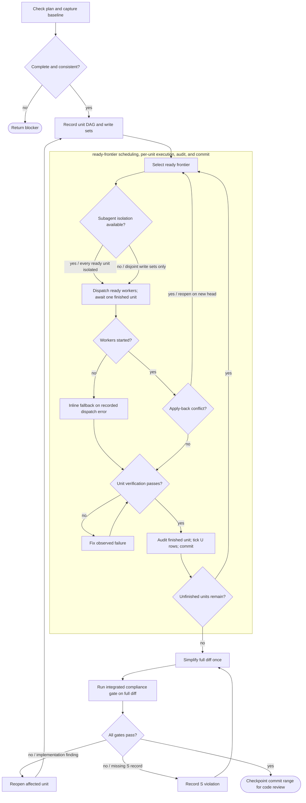

# Wayne Work

Execute one approved implementation plan to verified, review-ready commits, one per plan unit.

## Boundary

Own implementation, plan-unit DAG tracking, test-as-you-go, integration, one commit per audited unit, U status updates, the single full-diff refinement pass, and the final work handoff. Own three distinct scopes and never merge them: the per-unit conformance audit as each unit finishes, the single refinement pass over the combined full diff after all units commit, and the single workflow-level compliance gate over the full diff. Do not redesign approved behavior, author a new plan/test matrix, change E status, branch, push, open a PR, verify, ship, or perform code-quality review — that stays with `wayne-code-review`.

The plan, decision log, test matrix, repository instructions, and dirty baseline are source contracts. Read `../_shared/pipeline-id-contract.md`; consume IDs only from their defining structures and never renumber upstream artifacts.

## Flow

## Process

Every step carries a scope label, and the whole-workflow gate never collapses into the unit loop. A `[per-unit]` step reads one unit's contract and diff. A `[whole-workflow]` step handles the run's complete inputs or full diff; repeat it only where the Flow requires. A per-unit check never replaces a whole-workflow step, and the whole-workflow gate never runs inside the unit loop.

| Scope | Steps | Runs | Reads | Compliance agent |
| --- | --- | --- | --- | --- |
| `[whole-workflow]` setup | A | once | all source contracts and starting baseline | no |
| `[whole-workflow]` DAG scheduling | C | before execution; again if a unit reopens | unit contracts, dependencies, write sets, current task state | no |
| `[per-unit]` dispatch and wait | D, R, F | as units become ready or retry | ready unit contracts, active worker handles, unit diff | no |
| `[per-unit]` verify | G | per finished unit or retry | that unit's contract, diff, and verification command | no |
| `[per-unit]` audit and commit | H | as each unit passes G; commits in dependency order | that unit's contract and actual diff | optional parallel read-only audit subagents; main commits |
| `[whole-workflow]` refinement | S | once after the last unit commit, before J | the full diff from baseline and Simplify's Work-integration contract | no |
| `[whole-workflow]` gate | J, L | once per full diff | complete spec, decision log, plan, all units, full diff | yes — one fresh read-only agent |

### A. [whole-workflow] Check the plan before starting

Resolve `<state>` with `../_shared/scripts/wayne-state-dir.sh` (`STATE=$(bash <skill-dir>/../_shared/scripts/wayne-state-dir.sh)`) before reading or writing the plan or any other `<state>` artifact. If the resolver fails, report that and stop; never fall back to a repo-local `.wayne/` or `/tmp`. The plan lives under `<state>/plans/` (absolute path); H writes U status there.

Read the repository instructions, approved plan, decision log, test matrix, and referenced spec completely. Also read `$STATE/runs/<topic>/context.md` and `$STATE/context.md` ([context model](../_shared/context-model.md)); if the task file is missing, run `wayne-context-init` for the topic as its own stage first. Do not start implementation until all of these are true:

- the plan is approved and no other active plan conflicts;
- every unit specifies its goal, dependencies, consumes/produces, files, approach/design, patterns, test scenarios, U/E ownership, and verification;
- all required U rows exist exactly once in the plan, all required E rows exist exactly once in the carried test matrix, and the plan's E snapshot matches that matrix;
- every planned file change is within the repository's and plan's allowed scope;
- no unresolved decision could change the implementation.

Assign each `Deferred to Implementation` item to one unit. Work may answer only mechanical questions directly observable in the repository or runtime; record the evidence in Work state.

If a missing answer changes behavior, scope, ownership, failure handling, compatibility, migration, or a public interface, stop and ask the user. Return the answer to Plan for revision and re-approval before implementing it. Do not invent missing rows, choose between conflicting sources, choose a default, or partially implement around a protected file.

When blocked, return the task's blocker contract with the reason, affected artifacts, owner, and user-facing explanation. Shared layouts are communication examples, not a required grammar; exact bytes or line counts matter only when the caller explicitly requires them.

Once these checks pass, capture starting HEAD, branch, status, existing dirty paths, and source artifacts. Keep this run baseline unchanged. Do not create a branch. If a baseline dirty path lies in any unit's write set, stop and ask the user: a unit commit cannot separate their edits from the unit's.

### C. [whole-workflow] Record unit DAG and write sets

The main agent must record the unit dependency DAG in Work task state before any implementation starts:

1. Build the unit dependency graph from each unit's full contract, relevant decisions, dependencies, consumes/produces, and exact write set. Track status in Work task state; no provider-specific task tool is required.
2. Assign each path one owner when the host lacks subagent isolation. Keep the matrix, checkpoint, shared integration files, scope state, and full verification main-owned; remove them from worker write sets.
3. Record every unfinished unit in Work task state with its dependencies and write set, followed by `S`, `J`, and `L` after all units finish. Show the DAG to the user before proceeding to D.

For example, if I1 and I2 are independent and I3 needs both, record `I1 (deps: none, write set: …)`, `I2 (deps: none, write set: …)`, and `I3 (deps: I1, I2, write set: …)`, followed by `S`, `J`, `L`. If the plan has only I1, record `I1 (deps: none, write set: …)`, then `S`, `J`, `L`.

If J reopens a unit, preserve completed work and existing commits, then mark the affected unit (and any invalidated dependent units) unfinished in Work task state before D dispatches again. Do not reset the run baseline or dispatch a worker from C.

### D. [per-unit] Dispatch ready units

In D, the main agent prepares and dispatches one worker agent per ready unit. A unit is ready as soon as all of its dependencies have passed audit and commit in H. Keep dispatching ready units while other workers run; never wait for a batch.

Before dispatching a ready unit, read its real source and existing tests. Confirm its inputs, outputs, and named consumers. If code contradicts a plan assumption, stop and return the conflict to planning.

Build each worker's packet from exactly what H will audit: one fixed unit ID; full goal, decisions, approach, named interfaces, and consumes/produces; exact allowed paths; the unit's test scenarios; and the unit's verification command. Hand the packet together with [the worker contract](references/implementation-worker.md) verbatim — that file owns the worker's authority, prohibitions, evidence duty, and return format, including the four statuses. Do not paraphrase it or make the worker rediscover the plan.

**Isolation and parallel dispatch policy:**

- If the host's subagent tool offers isolation (in omp, the `task` tool's `isolated: true`), dispatch every ready unit with it. Units with overlapping write sets may then run in parallel. The tool creates the worktree and applies successful changes back to the parent. Never create, inspect, or manage a worktree yourself. If the tool reports an apply-back conflict, reopen that unit on top of the new HEAD.
- If the host has no subagent isolation (for example codex), launch in parallel only ready units whose dependencies have passed H and whose write sets are disjoint. If two ready units share a path, dispatch one fresh worker agent at a time and record the conflicting path.
- Serial execution never authorizes inline implementation.

Count a worker dispatch as started only when the tool returns a real worker handle or result. If the tool is unavailable or dispatch fails, quote the exact error in both the handoff and final result, then use F's inline fallback. Never claim parallel execution after a dispatch error.

Outside that recorded fallback, the main agent does not implement units. It owns scope, shared integration, actual-diff audits (or parallel read-only audit dispatch), U status, unit commits, and S's full-diff refinement.

Handle each worker's result as follows:

- `DONE` enters verification.
- `DONE_WITH_CONCERNS` enters verification only when the concern is observational; correctness, scope, or ownership concerns block the unit.
- `NEEDS_CONTEXT` may receive existing repository or plan context and retry the same unit; it never receives a new decision invented by the main agent.
- `BLOCKED` is never retried unchanged. A source or Plan gap follows A and asks the user. A mechanical obstacle may be decomposed within the same plan unit: record the revised steps and their dependencies in Work state before dispatching a fresh worker agent. Keep the unit ID, behavior, write boundary, and pre-unit HEAD baseline. New plan units or changed unit dependencies require Plan revision, not an unrecorded dispatch.

After handling any result, take its `## Context gaps` lines and append each one to `$STATE/runs/<topic>/context.md` under its layer, or under `## Unknown`, with the unit ID as source. The main agent is the only writer of that file in this run; workers report, they do not write it. This is a context write, not a unit edit: it never enters a unit commit.

### R. [per-unit] Dispatch ready workers and await one result

Follow D's dispatch and isolation policy. Dispatch all unstarted ready units allowed by the host's isolation rule without waiting for already-running workers, then collect one finished worker result. When no new unit is ready because remaining units depend on in-flight workers, await one active worker without re-dispatching running units.

Whenever a finished unit completes H and unlocks a dependent unit, return immediately to D to dispatch that newly ready unit while sibling workers keep running.

The worker agent follows the unit execution note. For test-first work, it runs the exact unit command before implementation and preserves the non-zero result. RED must fail for missing behavior, not environment or tooling. Diagnose unexpected failures before coding. Never edit, delete, skip, or weaken a locked test to manufacture GREEN.

### F. [per-unit] Implement the unit

Change only plan-owned files and implement the named interfaces exactly. Preserve decision semantics, state ownership, error behavior, and existing repository patterns. Add tests only when the plan assigns test authorship to this stage; when tests are locked, treat them as immutable acceptance inputs.

Do not add adjacent cleanup, defensive behavior, fallback paths, generalized abstractions, or compatibility work merely because they seem useful. When such a change is necessary for correctness, the Plan is incomplete: stop and follow the boundary process instead of expanding the unit.

Inline execution is a fallback, not a choice: use it only after an observable native-dispatch failure whose exact tool error is recorded and quoted. Every implementer reports actual paths changed and commands run; no worker commits or updates matrix/E ownership — H commits each unit in the main agent.

### G. [per-unit] Verify and repair from evidence

Run the unit's exact verification command. If it fails, connect the failure to the smallest source correction, apply it, and rerun the same command. Do not broaden scope, add speculative fallback, or swap in an easier check. A provider/tool failure is not a behavioral test result.

### H. [per-unit] Audit finished unit, update U status, and commit

When a unit passes G, inspect its actual diff rather than trusting worker summaries, against only the corresponding approved plan unit. Confirm the diff implements that unit's goal, named interfaces, consumes/produces, allowed write set, test scenarios, and verification command, and changes nothing the unit does not own. Judge by reading the diff against the unit text; CLI output, regex, keywords, or validator status cannot substitute.

When several finished units await audit at the same time, the main agent may dispatch parallel read-only audit subagents (one per unit, scoped strictly to that unit's contract and diff). Do not broaden any unit audit past the unit: not the complete spec, not the decision log, and not other units. A decision is audited here only when the unit contract already carries it; everything else belongs to J.

Any change the unit does not cover fails the unit and returns to Plan/user instead of being normalized into the diff. If the tool reports an apply-back conflict for an isolated unit, reopen that unit on top of the new HEAD instead of normalizing the conflict. A shared path does not make two units atomically coupled: each unit keeps its own commit. When a unit's paths still hold another unit's uncommitted changes, commit it through a separate index (shared-path commit below). If that unit's own patch cannot be isolated, commit the first unit, then reopen the later unit on top of the new HEAD. Separately from unit audits, once all producers of a main-owned shared integration edit or check pass audit and commit, perform that integration edit and run plan-defined integration checks before dispatching units that depend on it. Reject cross-owner writes in shared-checkout mode.

Only after each real unit test passes, change its plan-owned U rows from `☐` to `☑` in the main agent. Never edit U scenario text, the plan's E snapshot, or any authoritative E row/status `⬜`.

Then commit the unit at once in the main agent, one commit per unit, serialized in dependency order:

- Name that unit's repository paths explicitly: `git add -- <paths>`, then `git commit -s -- <paths>`, never `git add -A`, `.`, or a bare `git commit`. The pathspec commits only those paths, so anything the user staged before the run stays staged and out of the unit commit. Include main-owned shared integration edits with the unit whose contract requires them; when two units are atomically coupled through one edit, commit them together and say why in the message. `<state>` artifacts are never committed.
- Shared-path commit: when another unit's uncommitted hunks sit in the same paths, the commands above would take them too. Use a temporary index that holds only this unit's patch, and pass no pathspec: `export GIT_INDEX_FILE=$(mktemp -u)`, `git read-tree HEAD`, `git apply --cached <unit.patch>`, `git commit -s`, `unset GIT_INDEX_FILE`, then `git reset -q -- <paths>` so the real index matches the new HEAD for those paths. The user's other staged paths stay untouched, and the other unit's hunks stay in the working tree. `<unit.patch>` is the `## Patch` block an isolated worker returns ([worker contract](references/implementation-worker.md)); never rebuild it from `git diff` of the shared tree, which mixes in the other unit. If `git apply --cached` fails, the patch is not isolated: commit the first unit and reopen this one on the new HEAD.
- Message and identity follow the global Commit Format: plan's Jira ticket or `feat:/`/`fix:/` prefix, the unit ID in the title, `[why]` from the unit goal, `[how]` from the approach.
- Record the SHA against the unit in Work state. The first unit commit's parent is the range base L hands to review.
- A J reopen adds a new commit for that unit. Never amend, squash, or rewrite an earlier unit commit.

### S. [whole-workflow] Simplify the full diff once

After the last unit in the DAG is committed in H and before entering J, run [wayne-simplify](../wayne-simplify/SKILL.md) once over the full diff (`<base>..<last unit commit>`), in the main agent, following its `## Inside wayne-work` contract. Do not run it between units. Only a plan containing a single trivial unit may skip this pass. Record the refinement outcome (applied/skipped edits and before/after verification results, or that skip reason) in Work state before entering J.

If `wayne-simplify` changes code, commit those edits in their own commit with explicit pathspecs (`git add -- <paths>` then `git commit -s -- <paths>`), and record that SHA in Work state. Never amend or squash earlier unit commits. J then re-proves the full diff including this commit.

### J. [whole-workflow] Run the integrated compliance gate

After all units finish H and S finishes (or records a permitted skip), run the plan's full verification and lint commands. Then dispatch one fresh read-only spec-compliance agent with the complete decision log, spec, plan, all units, and the full diff. It must flag missing, changed, and extra behavior or files by contextual reading; CLI output, regex, keywords, headings, or validator status cannot substitute. This gate judges spec, decision, plan, scope, and cross-unit conformance — not general code quality, which stays with `wayne-code-review`.

The receipt covers only the diff the gate was given — the base recorded in A through the last unit or simplify commit. An implementation finding reopens the affected unit under the same unit boundary and returns to C to update Work state; D dispatches its fresh worker. A plan or spec gap returns to Plan/user. Any correction invalidates the receipt: rerun the gate on the corrected full diff before continuing. Then audit:

- every unit is DONE with its produces consumed where planned;
- all requirements and decisions have implementation evidence;
- the diff contains only plan-owned source, authorized U status changes, and work state; starting Git status, agent write history, and final diff show no unrelated or locked-input mutation;
- every U row is `☑`, every E row remains `⬜`;
- an S record exists for the run — the refinement outcome with before/after verification (and its own commit SHA if code changed), or the permitted single-trivial-unit skip reason — recorded before J ran. If not, record the violation in Work state and the handoff (V), run S on the current full diff (committing any S edits in their own commit), then rerun this gate on the corrected full diff. The rerun satisfies this check; it does not erase the violation;
- every unit has its own commit (or a recorded coupled commit) containing exactly its audited paths, plus a separate commit for S if S changed code; nothing is left staged or uncommitted except baseline dirty paths; no branch, push, amend, or downstream action was introduced; judge completeness from code, tests, and plan obligations rather than a substring scan.

Do not claim completion while any command, unit, U row, decision, or scope gate is unresolved.

### L. [whole-workflow] Handoff to wayne-code-review

Run this once per run, after J passes; it is never a per-unit step. Write one packet under `$STATE/checkpoints/` through `wayne-checkpoint` return-only mode or a supplied canonical contract (`STATE` already resolved in A; do not skip A because checkpoint will write the packet). Verify the file exists and surface its path; without either mechanism, return the shared blocker information. Include plan/matrix paths, units with their commit SHAs (plus any simplify commit SHA), the review range `<base>..<last commit>`, passing commands, changed paths, preserved scope, residual risks, and `next_agent: wayne-code-review`; final output repeats that literal but never invokes it.

## Red lines

- No implementation with incomplete/conflicting source contracts.
- No inline implementation without an observable, quoted native-dispatch error.
- No provider-specific task API, shell-process substitute, silent serial fallback, or claimed parallel success after a tool error.
- No compliance agent inside the per-unit loop, no per-unit audit substituted for the whole-workflow gate, and no gate receipt carried over a corrected diff.
- No test weakening, hidden substitute command, unchecked U row, or changed E row.
- No completion claim without full verification and actual scope-diff proof.
- No mention of a database write (report, RESULT, chat) without its host, container, database name, owner and the command in the same sentence.
- No branch, push, amend of a unit commit, `git add -A`, code-quality review, verify, ship, or auto-advance.
